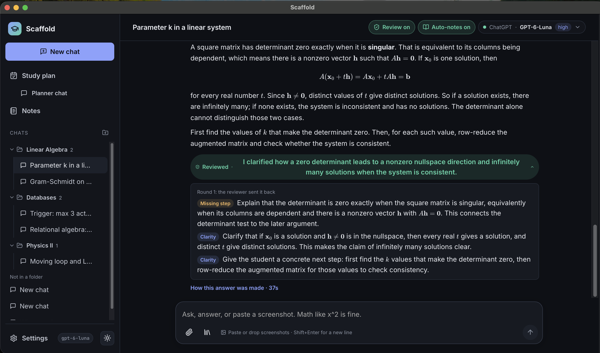
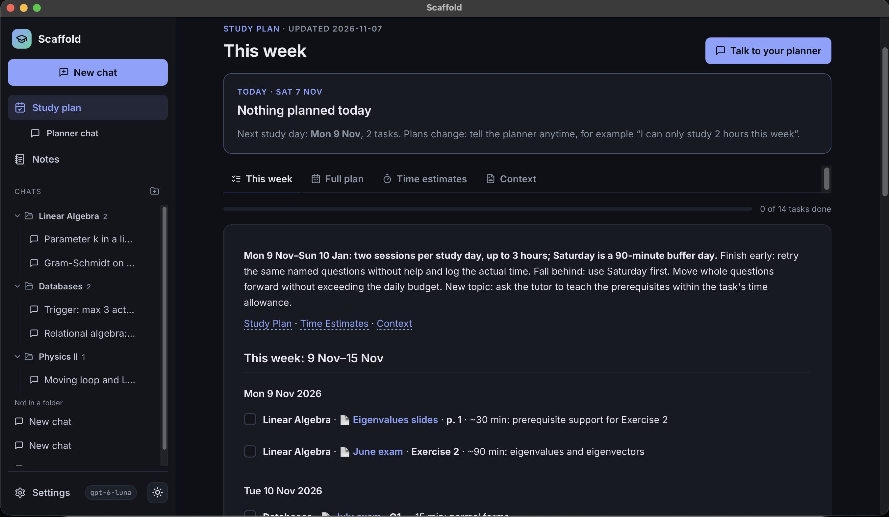

<div align="center">

# 🎓 Scaffold

**An agentic study app that plans your semester, teaches you from your own materials, and never just hands you the answer.**

*Built for Clash Reply · Student Tech Clash 2026: AI on Campus*

`Planner` → `Tutor` ⇄ `Reviewer` → `Notes` + `Memory`

<br>



<sub>The <b>Reviewer</b> caught a missing step and sent the lesson back before the student saw it. Expand <i>Reviewed</i> to see exactly what it fixed.</sub>

</div>

---

## ✨ What it does

| | |
| --- | --- |
| 🗓️ **Study planner** | Just talk to it. Pick your materials folder; the Planner reads every past exam and *asks you* about exam dates, hours per day and weekends. Then it writes **Quick Plan**, **Study Plan**, **Time Estimates** and **Context** as markdown files you keep. |
| ⏱️ **Real time estimates** | Minutes come from the material itself (points, exam length, question type, how new the topic is), not "90 min per block". Logging progress recalibrates them. |
| ✅ **Daily check-in** | Each day mark tasks as *done*, *took a different time* or *skipped* (or "I didn't study today") and press **Update my plan**. Or just tell the Planner in its chat. It reschedules and recalibrates every file. **Study this** opens a tutor chat on that exact exercise. |
| 🧑‍🏫 **Tutor** | Teaches from zero, anchored to a real exercise. Guides you step by step. Doesn't solve it for you. |
| 🔍 **Reviewer** | A second agent checks every tutor reply for correctness, completeness and answer-giving *before* you see it. |
| 🧠 **Personal memory** | Criticise the teaching ("you skipped why this works") and it becomes a lasting rule for **you**: general rules, plus a separate memory for each course. |
| 📝 **Notes agent per course** | After every reviewed answer, the course's own Notes agent updates your notes (section by section, so nothing you wrote is lost) and a Notes reviewer checks the change. A card under the answer shows what changed; reply to it ("put the derivation first") and the note is fixed and the preference remembered. |
| 🔗 **Your Codex chats** | Continue the chats you already have in the Codex app or CLI, not copies. Scaffold sends your messages into the same thread, the Reviewer checks Codex's answers, and the Notes agent takes the notes. |
| 💬 **Smooth chatting** | Queue a follow-up while it answers (↵) or steer the current answer (⌘↵), stop it, attach screenshots and files anywhere (planner included), and type `/` for commands like `/compact`. A context meter shows when the chat gets compacted. |
| ✍️ **Live-preview editor** | Formatting, math, tables, callouts, properties and tags render as you type; raw markdown appears only on the line you're editing. Autosaves. |
| 🔌 **Any model** | ChatGPT subscription (Codex CLI), Claude subscription (Claude Code CLI), OpenAI API key, Anthropic API key. Pick a model per agent in the UI. |
| 🎛️ **You're in control** | Every system prompt and the memory are editable in Settings. Point Scaffold at your existing notes vault, plan folder and course materials. |

<div align="center">



<sub>The <b>study plan</b>: built from a conversation, with real time estimates for every exam question and a daily check-in.</sub>

</div>

## 🚀 How to run

```bash
./run.sh          # web version: open http://127.0.0.1:8765 in any browser
./run.sh --app    # desktop app: the same thing in its own native window
./run.sh --demo   # the demo semester, in its own workspace-demo/ folder on port 8766 (add --app for the window)
```

**As a real Mac app** (Spotlight, Launchpad, Dock): run `scripts/make-mac-app.sh` once. It installs **Scaffold.app** into `~/Applications`, so ⌘Space → "Scaffold" opens it.
> macOS protects `~/Documents`, `~/Desktop` and iCloud Drive from apps you made yourself. Allow Scaffold once: System Settings → Privacy & Security → **Full Disk Access** → **+** → choose `~/Applications/Scaffold.app` → turn it on. (Running `./run.sh` from Terminal needs nothing extra.)

The script creates the Python env, installs the frontend packages, builds the UI and starts the server (with `--demo`, it also generates the demo semester).

**You need:** Python 3.12+, [uv](https://docs.astral.sh/uv/), Node 20+, and at least one model provider:

- **ChatGPT subscription:** install the Codex CLI and run `codex login` *(default and used for the demo)*
- **Claude subscription:** install Claude Code and log in
- **API keys:** paste an OpenAI or Anthropic key in **Settings → Models**

<details>
<summary><b>Development mode (hot reload)</b></summary>

```bash
# terminal 1: backend
cd backend && .venv/bin/python -m uvicorn app.main:app --port 8765 --reload --timeout-graceful-shutdown 2
# terminal 2: frontend on http://localhost:5173 (proxies /api to the backend)
cd frontend && npm run dev
```
</details>

## 🎬 Demo data

No materials at hand? Run `./run.sh --demo` (add `--app` for the window). It opens a separate demo workspace (`workspace-demo/`, on port 8766) with 3 courses of synthetic past exams (`demo-materials/`), finished notes, demo chats, a pre-built study plan and the Reviewer test reports. Demo data is only loaded from the command line and only into that demo workspace: it never touches your own notes, chats or settings.

## 🧪 Does the Reviewer actually help?

```bash
cd backend && .venv/bin/python -m harness.followups
```

This runs scripted student conversations through the real app, with the Reviewer **off** and **on**: start from zero → "just tell me the answer" → a wrong attempt → "you skipped why" → the correct answer. A judge agent grades every tutor reply (gave the answer early? found the first wrong step? taught the prerequisites? one clear next step?). The report is written to `notes/Evaluation/Reviewer Follow-up Test.md`.

### Agent audit

```bash
cd backend && .venv/bin/python -m harness.agent_audit --runs 3 --model=gpt-6-luna --reviewer-model=gpt-6.1-terra
```

27 cases, each run several times, check the mistakes students hate: a Reviewer that blocks a correct answer, asks for shorter answers, can't see an earlier screenshot or wants notes written; a Notes agent that loses or deletes content or writes answers the student has not reached; a memory that saves one-off requests. It uses a throwaway workspace, never your data.

## 🧭 Architecture

```
frontend/  React + Vite · KaTeX math · dark/light theme
backend/   FastAPI · PyMuPDF (PDF text + page images)
  app/llm.py        one interface for every provider: complete(system, messages, images) → text
  app/planner.py    setup → inventory → Planner → 4 plan files; log progress → Plan updater
  app/materials.py  scan, classify (exam / solution / slides / exercises), course-aware search, render pages
  app/chat.py       Tutor ⇄ Reviewer loop, queue / steer / stop, /commands, compaction, memory
  app/notesagent.py one Notes agent per course: section edits, Notes reviewer, correction cards
  app/codexlink.py  read Codex threads from ~/.codex and continue them with `codex exec resume`
  app/prompts/      default prompts (overridable in Settings)
workspace/          your data, local only: settings, memory, notes, chats, prompt overrides
```

Everything stays on your computer. Notes are plain `.md`, so you can point the notes folder at an Obsidian vault.

## 🗂️ What the planner writes

```
notes/Study Plan/
  Quick Plan.md      this week as a checklist: file link · question range · ~minutes
  Study Plan.md      weekly hours per course, assignments by week, coverage, mock exams
  Time Estimates.md  exam anchors, per-question estimates with reasons, does-it-fit, calibration
  Context.md         material inventory, exam rules, preferences, unknowns, dated updates
```

## 📄 License

[MIT](LICENSE): free to use, modify and share.
